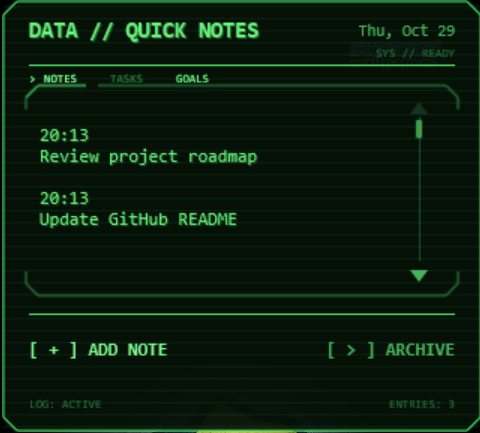
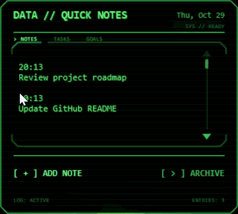

# Matt Daily Dashboard

A retro CRT / Pip-Boy-inspired productivity dashboard built with **Rainmeter, Lua, and PowerShell**.

Matt Daily Dashboard combines quick note capture, task management, repeat-goal tracking, productivity statistics, achievements, and persistent local storage inside a compact desktop widget.

<p align="left">
  
</p>

> **Version 1.0 — Stable**

---

## Overview

Matt Daily Dashboard started as a simple desktop note widget and gradually evolved into a small state-driven productivity application.

The goal was to create something lightweight and useful for everyday organization while making the experience feel more like an interactive terminal system than a traditional to-do list.

The interface uses a monochrome CRT aesthetic with:

- phosphor-green typography
- glow effects
- CRT scanlines
- subtle flicker
- system status indicators
- command-style navigation
- animated achievement feedback

---

## Features

### Notes

The Notes view provides quick daily capture directly from the desktop.

Features include:

- timestamped entries
- multi-line notes
- automatic text wrapping
- scrolling
- entry counting
- empty-state handling
- manual archiving
- automatic daily archiving

Archived notes are stored as readable Markdown instead of a proprietary format.

---

### Task Management

Tasks can be created as either:

- **Normal tasks**
- **Repeat tasks**

Normal tasks behave like traditional to-do items and can be marked complete or incomplete.

Repeat tasks remain active after completion and instead record individual completion events.

Tasks can also be:

- viewed
- edited
- deleted
- completed
- tracked through history

---

### Repeat Goal Tracking

Repeat tasks can optionally track:

- weekly targets
- monthly targets
- weekly + monthly targets
- no target

For example:

```text
Jump rope
Weekly target: 5
Monthly target: 20
```

Completion progress is calculated from stored completion events rather than from a simple mutable counter.

This allows the application to preserve historical activity while dynamically calculating weekly and monthly progress.

---

### Goal Dashboard

The Goals view displays tracked repeat tasks and their current progress.

It includes:

- weekly view
- monthly view
- progress bars
- completion counts
- scrolling for larger goal lists
- recent completion history
- productivity statistics

---

### Achievement System

Matt Daily Dashboard includes a progression system tied to completed objectives.

Progression tracks include:

- Weekly
- Monthly
- Dual
- Total

Achievement thresholds begin at:

```text
1 → 5 → 10 → 25 → 50 → 100 → ...
```

Higher levels continue scaling beyond the initial thresholds.

Each track displays:

- current level
- completed objective count
- next threshold
- visual progress

---

### Special & Secret Badges

In addition to progression achievements, the widget includes behavior-based badges.

Current badges include:

| Badge | Requirement |
|---|---|
| **First Signal** | Unlock any achievement |
| **Dual Sync** | Complete a dual-target objective |
| **Night Owl** | Unlock an achievement between midnight and 4:59 AM |
| **Early Bird** | Unlock an achievement between 5:00 AM and 6:59 AM |
| **Overdrive** | Unlock three achievements in one day |
| **Perfect Week** | Complete every active weekly goal |

Some secret badges remain hidden until they are discovered.

---

## Demo

<!-- Replace this file with your own GIF when ready -->



---

## Architecture

The project is split across three main technologies.

### Rainmeter

Rainmeter handles the desktop interface and rendering layer, including:

- UI layout
- meters
- input controls
- view switching
- interaction
- visual effects
- animations
- status indicators

### Lua

Lua handles most of the application logic.

It is responsible for:

- reading and rendering notes
- task rendering
- scrolling
- goal calculations
- statistics
- state management
- achievement progression
- badge logic
- navigation
- history views

### PowerShell

PowerShell is used for persistent file operations, including:

- saving notes
- archiving notes
- creating tasks
- editing tasks
- deleting tasks
- toggling task completion
- clearing completed tasks
- recording repeat-task completion events

---

## Project Structure

```text
matt-daily-notes/
│
├── DailyNotes.ini
│
├── README.md
│
├── .gitignore
│
├── Assets/
│   ├── dashboard.png
│   └── demo.gif
│
├── @Resources/
│   ├── ReadNotes.lua
│   ├── ReadTasks.lua
│   ├── GoalTracker.lua
│   ├── GoalInsights.lua
│   ├── Achievement.lua
│   ├── ViewController.lua
│   ├── EntryCount.lua
│   │
│   └── Sprites/
│
└── Scripts/
    ├── AddNote.ps1
    ├── AddTask.ps1
    ├── ArchiveNotes.ps1
    ├── ClearCompletedTasks.ps1
    ├── DeleteTask.ps1
    ├── EditTask.ps1
    └── ToggleTask.ps1
```

---

## Data Model

### Tasks

Tasks use the following format:

```text
status|type|id|weeklyGoal|monthlyGoal|text
```

Example:

```text
0|repeat|12|5|20|Jump rope
```

Fields:

```text
status       0 = active, 1 = completed
type         normal or repeat
id           unique task identifier
weeklyGoal   weekly completion target
monthlyGoal  monthly completion target
text         task name
```

---

### Completion History

Repeat-task completion events are stored separately:

```text
taskId|timestamp
```

Example:

```text
12|2026-10-29T14:32:17
```

This event-based structure allows the application to calculate weekly and monthly progress from historical data rather than relying on a single stored counter.

---

## Local-First Design

Matt Daily Dashboard does not require a database, account, API, or cloud service.

Application data is stored locally using plain-text files.

This keeps the project:

- lightweight
- transparent
- portable
- easy to inspect
- easy to back up

Personal note and history files are intentionally excluded from the public repository.

---

## Notes Archive

Archived notes are written to:

```text
Documents\Daily Notes\Daily Notes.md
```

Each day becomes its own Markdown section.

Example:

```markdown
## October 29, 2026

14:20
Finish GitHub README

16:05
Test achievement system
```

---

## Installation

### Requirements

- Windows
- [Rainmeter](https://www.rainmeter.net/)
- PowerShell

### Setup

1. Clone or download this repository.

2. Place the project folder inside:

```text
Documents\Rainmeter\Skins\
```

For example:

```text
Documents\Rainmeter\Skins\MattDailyDashboard\
```

3. Open Rainmeter.

4. Refresh the skin list.

5. Load:

```text
MattDailyDashboard\DailyNotes.ini
```

---

## Development Highlights

Some of the more interesting engineering challenges in the project included:

- coordinating application state across multiple Rainmeter views
- maintaining persistent task IDs
- separating task configuration from completion history
- dynamically calculating weekly and monthly progress
- preventing UI state from leaking between views
- implementing task creation and editing workflows
- building scrollable interfaces within Rainmeter
- coordinating Rainmeter, Lua, and PowerShell
- designing achievement progression
- implementing hidden badge conditions
- managing persistent local data without a database

---

## Version 1.0

Version 1.0 includes:

- quick notes
- note archiving
- normal tasks
- repeat tasks
- task editing
- task deletion
- weekly goals
- monthly goals
- goal history
- productivity statistics
- achievement progression
- special achievements
- secret achievements
- achievement popups
- persistent local storage
- CRT-inspired interface

The primary application flows were smoke-tested before the v1.0 release.

---

## Future Ideas

Possible future versions may explore:

- streak tracking
- additional achievement types
- expanded analytics
- customizable themes
- configurable settings
- data export/import
- additional productivity modules

Version 1.0 is currently considered feature-complete.

---

## Author

**Matias Franco**

Built as a personal productivity tool and software engineering project using **Rainmeter, Lua, and PowerShell**.
